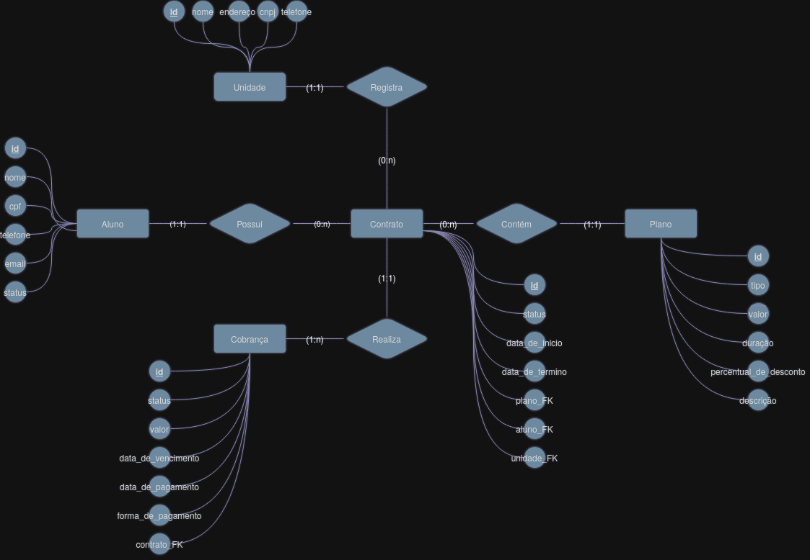

# Sistema de Gestão de Academia

Projeto acadêmico desenvolvido para a disciplina de **Desenvolvimento de Aplicações Web II (DAW2)**
no IFPB — Campus Esperança.

**Grupo:** Samuel Cláudio Duarte Lima, João Augusto Silva de Araújo, Arley Andrey Alves Pereira, Miguel Rodrigo da Silva Normando

---

## Sobre o sistema

Plataforma centralizada de controle financeiro e de acesso físico para uma rede de academias de ginástica. O sistema integra gestão de cobranças e mensalidades com controle de catraca por unidade.

**Fora do escopo:** controle de treinos, agendamentos, cadastro de funcionários e modalidades online.

## Stack

- Java + Maven
- Banco de dados relacional
- Orientação a Objetos

## Modelo Conceitual (MER)

O modelo contempla as entidades **Unidade**, **Aluno**, **Plano**, **Contrato** e **Cobrança**.
Principais decisões de modelagem:

- O aluno não está vinculado a uma unidade fixa — a unidade fica registrada no contrato, permitindo que o aluno frequente diferentes unidades ao longo do tempo.
- Renovações geram um novo contrato, preservando o histórico.
- Não há relacionamentos N:N no modelo conceitual.

## Documentação

- [`docs/Minimundo_DAW2_v3.docx`](docs/Minimundo_DAW2_v3.docx) — descrição completa do domínio e regras de negócio.
